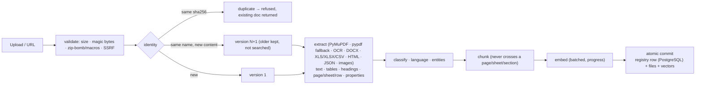
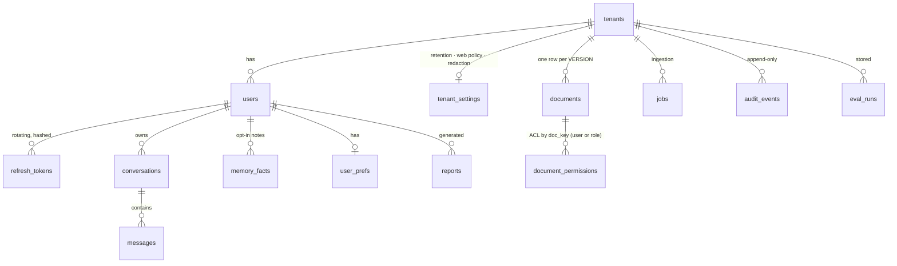

# Architecture

All diagrams are [Mermaid](https://mermaid.js.org/) (rendered by GitHub); the same views are drawn in the BRD PDF.

## 1. System context

```mermaid
flowchart LR
  user([Browser: React + TypeScript]) -->|"HTTPS · JWT in memory · httpOnly refresh cookie"| api
  subgraph api["FastAPI application (API tier, stateless)"]
    direction TB
    auth["auth · RBAC · tenants · rate limit · audit"]
    routers["routers: sources · chat/stream · search/exact · summaries · compare · analytics · web · reports · memory · eval · admin"]
    graph["LangGraph supervisor + agents"]
    obs["/metrics · OpenTelemetry · request IDs"]
  end
  api --> pg[("PostgreSQL 16<br/>users · tenants · documents + versions + ACL<br/>jobs · conversations · memory notes · reports · audit<br/>LangGraph checkpoints")]
  api --> redis[("Redis 7<br/>job queue · shared rate limits · scheduler lock")]
  api --> vec[("Vector store<br/>Qdrant (prod) · Chroma (dev) · local")]
  api --> vol[("Data volume<br/>original files · units · chunks · tables · graph · reports")]
  worker["Ingestion worker(s)<br/>python -m app.worker"] --> redis & pg & vec & vol
  sched["Scheduler<br/>python -m app.scheduler"] --> pg & vol & vec
  api -.->|optional| llm["LLM / embedding provider (OpenAI · Gemini)"]
  api -.->|"approved domains only"| web["Public web (SSRF-guarded)"]
  api -.-> otel["OTLP collector · Prometheus · LangSmith"]
```

## 2. Agent graph (LangGraph)

```mermaid
flowchart TD
  S[Supervisor<br/>rules or LLM routing + intent splitting] -->|single intent| E[Exact Search]
  S --> D[Data Analyst<br/>pandas plans · sandboxed SQL · charts]
  S --> SEM[Semantic / Document Agent<br/>advanced RAG + Self-RAG]
  S --> DS[Document Search]
  S --> SUM[Summary Agent<br/>short · detailed · executive · chapter · section]
  S --> CMP[Comparison Agent<br/>diff · versions · contradictions]
  S --> W[Web Research Agent<br/>approved sources · separate evidence]
  S -->|"compound question: Send × N"| B["Branch × N (parallel)<br/>agent + verification pass"]
  B --> M[Merge]
  SEM --> V
  DS --> V
  SUM --> V
  CMP --> V
  W --> V[Verification Agent<br/>numbers · citations (page/row/text) · judge]
  V -->|"retry ≤ max_retries:<br/>1st widened retrieval, then strict extraction"| SEM
  V --> F[Final Response<br/>followups · language · trace]
  E --> F
  D --> F
  M --> F
  SEM -.->|abstained + web fallback| W
  D -.->|not a table question| SEM
```

Every node runs under `metered()`: per-node **timeout** (`MKA_NODE_TIMEOUT_S`), **retry** on transient provider errors, usage/cost accounting, a Prometheus histogram and an OpenTelemetry span. State is typed (`AgentState`), checkpointed (memory / SQLite / PostgreSQL) and JSON-serialisable.

## 3. Ingestion pipeline



## 4. Retrieval pipeline

```mermaid
flowchart LR
  q[Question] --> rw[rewrite] --> mq[multi-query / HyDE (embedding only)] --> ret["BM25 ∥ vectors → RRF"] --> flt[ACL + metadata filters] --> par[parent expansion] --> rr[rerank] --> cmp[compression] --> gr[grade: correct / ambiguous / incorrect]
  gr -->|"ambiguous/incorrect, bounded"| rw
  gr --> sr["Self-RAG (optional): retrieve? → passage relevance → sentence support critique → bounded regeneration"] --> ans[answer + citations] --> ver[Verification]
```

HyDE text is only ever embedded to find neighbours; it is never passed to the answer step as evidence.

## 5. Data model (PostgreSQL)



Indexes cover every list/filter path (tenant+workspace+current, content hash, doc_key, tenant+created, audit by tenant/action/time, reports by tenant+created). Migrations: `migrations/versions/0001` (baseline v2.0) and `0002` (registry, versions, ACL, roles, refresh tokens, memory, reports); `alembic check` verifies they match the models.

## 6. Security layers

| Layer | Controls |
|---|---|
| Identity | bcrypt passwords · 15-minute JWT access token (memory only) · rotating 14-day refresh token (httpOnly, SameSite=Strict, hashed in DB, family revocation on reuse) · roles `user` / `manager` / `admin` |
| Isolation | tenant + workspace in every storage address · mandatory Qdrant filters · document-level ACL (tenant / private / restricted to users or roles) · hidden documents are indistinguishable from missing ones |
| Input | upload size, magic bytes, zip-bomb and macro checks · SSRF-safe fetch with pinned IP + SNI · prompt-injection scan, data fences, closed tool registry |
| Execution | no generated code is ever executed; SQL is single-statement SELECT in an in-memory SQLite guarded by an *authorizer* (function/table whitelist), length/row/time limits |
| Output | output guard · citation validation against stored text · XLSX cell-formula neutralisation · CSP (`img-src 'self' data: blob:`) |
| Data lifecycle | per-tenant retention (documents, conversations, audit ≥ 30 d, reports) enforced by the scheduler · user/tenant purge · memory reset · PII redaction option |
| Operations | rate limits (Redis-shared) · append-only audit (hashes, never text) · secrets from env or `*_FILE` · production start-up validator |
